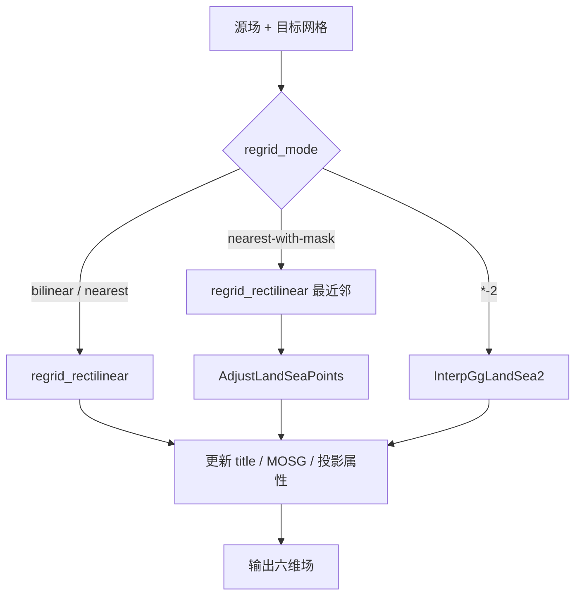

# interpolation_grid_grid 算法说明

将源格点场重采样到目标水平网格。面向 `meteva_base` 六维场（`member, level, time, dtime, lat, lon`）。

包内两类能力：

- **等距经纬插值（InterpGg\*）**：`InterpGgLinear` / `Nearest` / `Cubic`；越界用 `outer_value`。
- **海陆感知重网格（LandSea）**：`InterpGgLandSea` 等；scipy / `*-2` 路径；可选海陆掩码。

---

## 1. 插件一览

| 插件 | 功能简介 |
| --- | --- |
| `InterpGgLinear` | 格点→格点双线性；四邻点距离加权 |
| `InterpGgNearest` | 格点→格点最近邻；索引四舍五入 |
| `InterpGgCubic` | 格点→格点双三次；三次卷积核加权 |
| `InterpGgLandSea` | 重网格统一入口：按 `regrid_mode` 分派 scipy 或 `*-2`，可选海陆 |
| `InterpGgLandSea2` | `*-2` 路径实现（规则网索引 + 距离/双线性；可选掩码） |
| `AdjustLandSeaPoints` | `nearest-with-mask` 事后海陆订正（通常由 `InterpGgLandSea` 调用） |

辅助：`regrid_rectilinear`（`src/utils/grid.py`）为 scipy 规则网插值，供 LandSea 的 `bilinear` / `nearest` 使用。

---

## 2. 目录结构

| 路径 | 内容 |
| --- | --- |
| `src/` | 插件 |
| `src/utils/` | LandSea 内核（经包级 `utils` 暴露） |
| `cli/` | Gg：`python -m cli`；LandSea：`python -m cli.tran_regrid` |
| `resource/conf.ini` | InterpGg CLI 缺省 |
| `test/` | 单元与示例 |
| `docs/` | 本文档 |
| `nbs/` | 说明与对比 Notebook |
| `utils/` | `util_env`、包内 `base_plugin`；并入共享 utils |

---

## 3. 等距经纬插值（InterpGg*）

接口统一：`process(grd, grid)`。`grd` 为源六维场，`grid` 为目标 `meb.grid`（等距经纬）。

### 3.1 共同约定

- 水平插值；源经度跨满 360°（`iscycle`）时经度取模；**纬度越界仍须** `outer_value`。
- 非循环场经纬越界：先插重叠区，再 `expand_to_contain_another_grid` 填外区；越界且未给 `outer_value` 时返回 `None`。
- `member` / `level` / `time` / `dtime` 继承源场；水平网格取自目标 `grid`；`attrs` 深拷贝自源场。

### 3.2 `InterpGgLinear`

将目标点映射到源索引分数，取四邻点双线性加权。

| 参数 | 位置 | 必填 | 默认 | 说明 |
| --- | --- | --- | --- | --- |
| `outer_value` | 构造 | 条件 | `None` | 目标超出源域时的填充值 |
| `grd` | `process` | 是 | — | 源格点场 |
| `grid` | `process` | 是 | — | 目标网格 |

```python
from interp_gg_linear_plugin import InterpGgLinear
import meteva_base as meb

grd = meb.read_griddata_from_nc("source.nc")
grid = meb.basicdata.grid([70, 140, 0.1], [15, 55, 0.1])
result = InterpGgLinear(outer_value=0.0).process(grd, grid)
```

### 3.3 `InterpGgNearest`

对索引 `np.around` 取最近源格点赋值。循环场经度取模；非循环场索引钳制在有效范围。参数表与 Linear 相同（`outer_value` / `grd` / `grid`）。

```python
from interp_gg_nearest_plugin import InterpGgNearest
result = InterpGgNearest(outer_value=0.0).process(grd, grid)
```

### 3.4 `InterpGgCubic`

对邻域 `p,q ∈ {-1,0,1,2}` 用三次核加权累加；邻点下标按源网格边界钳制。参数表与 Linear 相同。

```python
from interp_gg_cubic_plugin import InterpGgCubic
result = InterpGgCubic(outer_value=0.0).process(grd, grid)
```

---

## 4. 海陆感知重网格（LandSea）

### 4.1 `regrid_mode` 一览

| `regrid_mode` | 路径 | 源掩码 | 说明 |
| --- | --- | --- | --- |
| `bilinear` | scipy `regrid_rectilinear` | 否 | 双线性 |
| `nearest` | scipy | 否 | 最近邻 |
| `nearest-with-mask` | scipy + `AdjustLandSeaPoints` | 是 | 先最近邻，再海陆订正 |
| `nearest-2` | `InterpGgLandSea2` | 否 | 自研最近邻 |
| `bilinear-2` | `InterpGgLandSea2` | 否 | 自研双线性 |
| `nearest-with-mask-2` | `InterpGgLandSea2` | 是 | 插值时按海陆改邻点 |
| `bilinear-with-mask-2` | `InterpGgLandSea2` | 是 | 插值时按海陆改权重 |

掩码约定：`land_binary_mask`（名称含该子串亦可），陆=1、海=0。

- **源掩码**：`InterpGgLandSea(landmask=...)`。
- **目标掩码**：`process` 第二参 `target_grid`（掩码模式下该场本身即目标掩码，并给出目标网格）。

`extrapolation_mode` **仅作用于 scipy 路径**；`*-2` 对源域外目标点固定填 NaN。

### 4.2 流程概要



**scipy（`regrid_rectilinear`）**：在源坐标系规则网上用 `RegularGridInterpolator` 采样；目标点先变换到源 CRS。

**`extrapolation_mode`（正式取值）**：

| 模式 | 行为 |
| --- | --- |
| `nan`（默认） | 域外填 NaN |
| `extrapolate` | 沿边界外推 |
| `error` | 越出源域抛错 |

历史别名 `mask` / `nanmask` 在入口归一为 `nan`。

**`AdjustLandSeaPoints`（`nearest-with-mask`）**：源掩码最近邻到目标后，与目标掩码比较；类型不一致且 `vicinity_radius` 内有同类型源点时，用同类型最近点替换；否则保持。先订正海点，再订正陆点。

**`InterpGgLandSea2`（`*-2`）**：源须为经纬规则网；裁源域→分域内/域外→四邻点索引→最近邻或双线性；带掩码时调整索引/权重；域外填 NaN。

### 4.3 `InterpGgLandSea`

业务主入口。

```python
from interp_gg_landsea_plugin import InterpGgLandSea

result = InterpGgLandSea(
    regrid_mode="bilinear",
    extrapolation_mode="nan",
    landmask=None,
    landmask_vicinity=25000,
).process(data, target_grid, regridded_title=None)
```

| 参数 | 单位 | 必填 | 默认 | 说明 |
| --- | --- | --- | --- | --- |
| `data` | — | 是 | — | 待重网格场 |
| `target_grid` | — | 是 | — | 目标网格模板；掩码模式为目标海陆掩码场 |
| `regridded_title` | — | 否 | `unknown` | 输出 `title` |
| `regrid_mode` | — | 否 | `bilinear` | 见 4.1 |
| `extrapolation_mode` | — | 否 | `nan` | 仅 scipy 路径 |
| `landmask` | — | 条件 | `None` | 源侧掩码；`*-with-mask*` 必需 |
| `landmask_vicinity` | m | 否 | `25000` | 同类型搜索半径 |

重网格后会尽量继承目标侧 MOSG 属性（`mosg__grid_type` / `version` / `domain`）与 `grid_mapping_attrs`。

### 4.4 `AdjustLandSeaPoints`

一般由 `InterpGgLandSea` 在 `nearest-with-mask` 时调用；也可单独使用。

```python
from interp_gg_landsea_plugin import AdjustLandSeaPoints

AdjustLandSeaPoints(
    extrapolation_mode="nan",
    vicinity_radius=25000.0,
).process(data, input_land, output_land)
```

| 参数 | 单位 | 必填 | 默认 | 说明 |
| --- | --- | --- | --- | --- |
| `data` | — | 是 | — | 已与目标网格对齐的场 |
| `input_land` | — | 是 | — | 源侧 `land_binary_mask` |
| `output_land` | — | 是 | — | 目标侧掩码；须与 `data` 空间坐标一致 |
| `extrapolation_mode` | — | 否 | `nan` | 源掩码最近邻到目标时的域外行为 |
| `vicinity_radius` | m | 否 | `25000` | 同类型搜索半径 |

### 4.5 `InterpGgLandSea2`

通常经 `InterpGgLandSea` 调用；源场须为经纬规则网。

```python
from interp_gg_landsea2_plugin import InterpGgLandSea2

InterpGgLandSea2(
    regrid_mode="bilinear-2",
    vicinity_radius=25000.0,
).process(data_in, data_in_mask, data_out_mask)
```

| 参数 | 单位 | 必填 | 默认 | 说明 |
| --- | --- | --- | --- | --- |
| `data_in` | — | 是 | — | 源场（经纬规则网） |
| `data_in_mask` | — | 条件 | — | 源掩码；无掩码模式可为 `None` |
| `data_out_mask` | — | 是 | — | 目标网格模板（掩码模式亦为目标海陆） |
| `regrid_mode` | — | 否 | `bilinear-2` | 仅 `*-2` 四种 |
| `vicinity_radius` | m | 否 | `25000` | 海陆搜索半径 |

### 4.6 scipy 与 `*-2` 差异

| 能力 | scipy（无 `-2`） | `*-2` |
| --- | --- | --- |
| 插值引擎 | `RegularGridInterpolator` | 规则网索引 + 距离 / 双线性权重 |
| 源网格 | 经纬或投影规则网 | **仅经纬规则网** |
| 目标网格 | 经纬或投影 | 经纬或投影 |
| 域外 | `extrapolation_mode` | 固定 NaN |
| 海陆 | 事后 `AdjustLandSeaPoints`（仅 nearest） | 插值时调整邻点 / 权重 |

---

## 5. CLI

均在**本包目录**执行。

### 5.1 InterpGg：`python -m cli`

`--module` 选 `linear` / `nearest` / `cubic`。目标网格须给 `--glon`+`--glat`，或 `--domain`，或 `--grid-template`。未写参数先读 `resource/conf.ini`，再无则用预设；`grid` 为空报错。

源场 / 模板格式：`--grid-type` / `--grid-template-type`（或 ini `[input]` 对应项）显式指定 `nc`/`m4`；未指定则按扩展名（`.nc`→nc，否则 m4）。输出仍写 Micaps4。

```bash
python -m cli --module linear --grid a.nc --domain 20,50,70,140,0.1,0.1 --outer-value 0
python -m cli --module nearest --grid a.nc --domain 20,50,70,140,0.1,0.1 --outer-value 0
python -m cli --module cubic --grid a.m4 --glon 70,140,0.1 --glat 15,55,0.1 --output out.m4
python -m cli --module linear --grid data/no_ext --grid-type nc --domain 20,50,70,140,0.1,0.1
```

### 5.2 LandSea：`python -m cli.tran_regrid`

```bash
python -m cli.tran_regrid --input-path in.nc --target-grid-path grid.nc --output-path out.nc
python -m cli.tran_regrid --input-path in.nc --target-grid-path tgt_mask.nc \
  --land-sea-mask-path src_mask.nc --regrid-mode nearest-with-mask --output-path out.nc
```

| 参数 | 说明 |
| --- | --- |
| `--input-path` | 源场 nc |
| `--target-grid-path` | 目标网格 nc；掩码模式为目标海陆掩码场 |
| `--land-sea-mask-path` | 源侧掩码；`*-with-mask*` 必需 |
| `--output-path` | 输出 nc；省略则只返回不写文件 |
| `--regrid-mode` | 默认 `bilinear` |
| `--extrapolation-mode` | 默认 `nan` |
| `--land-sea-mask-vicinity` | 默认 `25000`（米） |
| `--regridded-title` | 输出 title |

代码调用：

```python
from cli.tran_regrid import process

result = process(
    "in.nc",
    "grid.nc",
    output_path="out.nc",
    regrid_mode="bilinear",
    extrapolation_mode="nan",
)
```

---

## 6. 选型与注意

1. **融合 / 背景对齐（meb 等距经纬）**：优先 `InterpGgLinear` / `Nearest` / `Cubic`。
2. **IMPROVER 式海陆重网格**：`InterpGgLandSea`；掩码模式需源、目标两份掩码。
3. 等距经纬、域内：`InterpGgLinear` 与 LandSea `bilinear` 通常接近；最近邻在格心附近可能有格点级差。
4. 输入宜已规范化为六维 meb 场；`*-2` 源场仅支持经纬规则网。
5. 依赖：`meteva_base`、`numpy`、`scipy`（LandSea）、包内 / 共享 `utils.base_plugin`。

说明与对比 Notebook：`nbs/interpolation_grid_grid_说明.ipynb`、`nbs/cmp_gg_vs_regrid.ipynb`。
