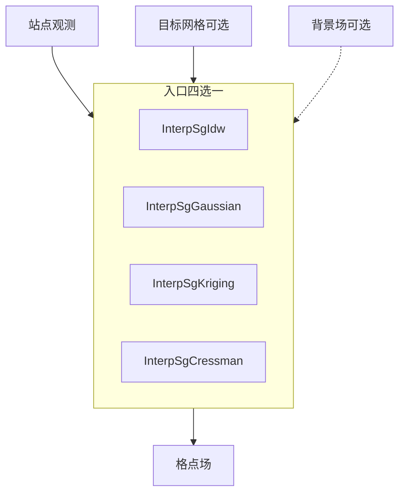

**基础信息**
- **所属包**: `interpolation_station_grid`
- **预报类型**: 语义与时空标准化
- **算法类别**: `ancillaries`
- **正式目录规划**: `NIMM/ancillaries/interpolation_station_grid/`
- **对外入口**: `InterpSgIdw`、`InterpSgGaussian`、`InterpSgKriging`、`InterpSgCressman`
- **CLI 页**: [interpolation_station_grid](https://www.showdoc.com.cn/2598854776811541/11559060627727594)

站点→格点插值：反距离（IDW / IDW×高斯）、最近邻×高斯、局部普通克里金、Cressman。统一接口 `process(sta, grid=None, background=None)`；由构造参数 **`reprocess`** 选择插值对象：`False` 直接用站点值插值，`True` 先算站点相对背景的偏差再对偏差插值并叠回（Cressman 为创新量累加）。`grid` 与 `background` 至少其一；缺 `grid` 时可从背景取水平网格。样例要素为阵风/风速（m/s）。读路径、写盘与命令行见 CLI 页。

**算法功能与流程**



1. **输入**：站点表；`grid` / `background` 至少其一（均可只传背景）。
2. **`reprocess=False`（默认）**：直接用站点值插值；IDW/Gaussian/Cressman 远点或圈外回退/保留背景初场；Kriging 无硬截断，有背景时**只取网格**。
3. **`reprocess=True`**：须 `background`；先算站点与背景场的偏差，再对偏差插值并叠回（Cressman 为相对当前分析场的创新量累加）。
4. **入口**：`InterpSgIdw`、`InterpSgGaussian`、`InterpSgKriging`、`InterpSgCressman`。

# InterpSgIdw

<div style="margin:8px 0;padding:10px 14px;background:#e8f3ff;border-left:4px solid #1677ff;border-radius:4px;overflow-x:auto;"><div style="margin:0;padding:0;background:transparent;border:none;color:#1677ff;font-weight:600;font-size:16px;line-height:1.55;font-family:Consolas,Menlo,Monaco,monospace;white-space:pre;">InterpSgIdw(<br>&nbsp;&nbsp;&nbsp;&nbsp;effectR=1000,<br>&nbsp;&nbsp;&nbsp;&nbsp;nearNum=8,<br>&nbsp;&nbsp;&nbsp;&nbsp;decrease=2,<br>&nbsp;&nbsp;&nbsp;&nbsp;gaussian=False,<br>&nbsp;&nbsp;&nbsp;&nbsp;outer_value=None,<br>&nbsp;&nbsp;&nbsp;&nbsp;reprocess=False,<br>).process(sta, grid=None, background=None)</div></div>

- `reprocess=False`：直接用站点值插值；`d > effectR` 回退背景（无背景填 0）。
- `reprocess=True`：须背景；先算站点与背景场的偏差，再对偏差插值并叠回（超距 Δ=0 → 保留背景）。
- `gaussian=True`：权重再乘 `exp(-(d/effectR)^2)`（CLI `--module idw_delta` 固定 `gaussian=True` + `reprocess=True`）。

**构造参数**

| 参数 | 说明 |
| --- | --- |
| <span style="color:#1677ff;font-weight:600;font-size:16px">effectR</span> | 纯 IDW：硬截断半径；高斯模式：高斯衰减尺度（米量级） |
| <span style="color:#1677ff;font-weight:600;font-size:16px">nearNum</span> | 每个格点参与加权的近邻站点数 |
| <span style="color:#1677ff;font-weight:600;font-size:16px">decrease</span> | 距离衰减指数 `1 / d^decrease` |
| <span style="color:#1677ff;font-weight:600;font-size:16px">gaussian</span> | 是否乘高斯核 |
| <span style="color:#1677ff;font-weight:600;font-size:16px">outer_value</span> | 背景对齐越界填充，传给 `InterpGgLinear` |
| <span style="color:#1677ff;font-weight:600;font-size:16px">reprocess</span> | `False`：直接用站点值插值；`True`：先算站点与背景场的偏差再对偏差插值 |

**process 参数**

| 参数 | 说明 |
| --- | --- |
| <span style="color:#1677ff;font-weight:600;font-size:16px">sta</span> | 待插值的**站点场**（meteva_base 站点表）。须含经纬与观测值；按 `member`/`level`/`time`/`dtime` 切片后分别插值。取值用表**末列**（多要素时只插最后一列）。无效值会先剔除。 |
| <span style="color:#1677ff;font-weight:600;font-size:16px">grid</span> | 目标**网格信息**（如 `meb.grid` / `meb.get_grid_of_data` 的返回），决定输出场的水平经纬范围与分辨率。默认 `None`：此时必须提供 `background`，并从中取 `glon`/`glat`。注意：传入的是网格定义，不是用来当背景场值的格点场。 |
| <span style="color:#1677ff;font-weight:600;font-size:16px">background</span> | 可选**背景格点场**（六维 `DataArray`）。`reprocess=False` 时：超 `effectR` 的格点用背景值回退（无背景则填 0）；也可仅用来提供网格。`reprocess=True` 时**必需**：在站点上插值出 `obs−bg`，再叠回对齐后的背景得到分析场。背景会经 `InterpGgLinear` 对齐到目标网格；越界行为由构造参数 `outer_value` 控制。 |
| <span style="color:#1677ff;font-weight:400;font-size:16px">return</span> | `xr.DataArray` 六维格点场（member/level/time/dtime/lat/lon）。`reprocess=True` 时成员名常为 `data0`；`False` 时多为站点要素名。`attrs` 继承自输入站点。 |

**使用示例**

包内真实样例：`resource/obs_gust_d24.csv`（阵风，dtime=24）与 `resource/bg_fcst_idw.nc`（约 0.1°）。本节演示 **`reprocess=True`（对偏差插值再叠回）**：先调用与返回，再画输入站点、订正前背景、订正后结果（共用 `wind_speed` 色标）。

```python
from pathlib import Path
import matplotlib.pyplot as plt
import meteva_base as meb
import numpy as np
from meteva_base.tool.color_tools import get_cmap_and_clevs_by_element_name
from meteva_base.tool.plot_tools import pcolormesh_2d_grid
from interp_sg_idw_plugin import InterpSgIdw

plt.rcParams["font.sans-serif"] = ["Microsoft YaHei", "SimHei", "DejaVu Sans"]
plt.rcParams["axes.unicode_minus"] = False

# 读站点与背景；目标网格可从背景取
PKG = Path("interpolation_station_grid/resource")
obs = meb.read_stadata_from_csv(str(PKG / "obs_gust_d24.csv"))
bg = meb.read_griddata_from_nc(str(PKG / "bg_fcst_idw.nc"))
tgt = meb.get_grid_of_data(bg)
map_extend = [float(bg.lon.min()), float(bg.lon.max()), float(bg.lat.min()), float(bg.lat.max())]

# reprocess=True：先算站点−背景偏差，再对偏差做 IDW 并叠回
fused = InterpSgIdw(
    effectR=150000, nearNum=8, decrease=2, outer_value=0.0, reprocess=True
).process(obs, tgt, background=bg)
print(fused)
```

```
<xarray.DataArray 'data0' (member: 1, level: 1, time: 1, dtime: 1, lat: 71,
                           lon: 210)> Size: 60kB
array([[[[[[14.652872 , 13.959169 , 13.870783 , ..., 12.191032 ,
            12.2226715, 12.262427 ],
           [14.890355 , 14.230514 , 14.153165 , ..., 12.084795 ,
            12.124977 , 12.172665 ],
           [15.165756 , 15.116795 , 14.50066  , ..., 11.965042 ,
            12.014806 , 12.07347  ],
           ...,
           [14.58208  , 14.638617 , 14.710728 , ..., 15.564529 ,
            15.691521 , 15.81501  ],
           [14.635724 , 15.337983 , 15.363322 , ..., 15.810974 ,
            15.8931465, 15.980846 ],
           [15.458416 , 15.473828 , 15.502932 , ..., 16.033077 ,
            16.083733 , 16.141905 ]]]]]],
      shape=(1, 1, 1, 1, 71, 210), dtype=float32)
Coordinates:
  * member   (member) <U5 20B 'data0'
  * level    (level) float32 4B 0.0
  * time     (time) datetime64[ns] 8B 2026-06-02
  * dtime    (dtime) int32 4B 24
  * lat      (lat) float64 568B 31.54 31.64 31.74 31.84 ... 38.34 38.44 38.54
  * lon      (lon) float64 2kB 99.6 99.7 99.8 99.9 ... 120.2 120.3 120.4 120.5
Attributes:
    units:               
    model_var:           
    dtime_units:         hour
    level_type:          isobaric
    time_type:           UT
    time_bounds:         [0, 0]
    data_start_columns:  6
```

```python
cmap, clevs = get_cmap_and_clevs_by_element_name("wind_speed")
clevs = np.asarray(clevs, dtype=float)

# 输入站点
axs = meb.creat_axs(1, map_extend, ncol=1, height=6.5, width=12, dpi=120,
                    title_list=["输入-站点阵风 obs_gust"])
meb.add_scatter(axs[0], obs, cmap=cmap, clevs=clevs, point_size=28, add_colorbar=True,
                title="输入-站点阵风 obs_gust", title_fontsize=12)
plt.savefig("sg_obs_sta.png", dpi=120, bbox_inches="tight"); plt.close("all")

# 订正前：背景场
pcolormesh_2d_grid(
    bg, save_path="sg_before_bg.png", title="订正前-背景场",
    cmap=cmap, clevs=clevs, show=False, dpi=120, height=6.5, width=12,
)

# 订正后：分析场 + 叠站
axs = meb.creat_axs(1, map_extend, ncol=1, height=6.5, width=12, dpi=120,
                    title_list=["订正后-InterpSgIdw"])
meb.add_contourf(axs[0], fused, cmap=cmap, clevs=clevs, cut_colorbar=False, add_colorbar=True,
                 title="订正后-InterpSgIdw", title_fontsize=12)
meb.add_scatter(axs[0], obs, cmap=cmap, clevs=clevs, point_size=28, add_colorbar=False,
                title="订正后-InterpSgIdw", title_fontsize=12)
plt.savefig("sg_idw_after.png", dpi=120, bbox_inches="tight"); plt.close("all")
```

输入站点阵风：


订正前-背景场：


订正后-InterpSgIdw（叠站，同色标）：


# InterpSgGaussian

<div style="margin:8px 0;padding:10px 14px;background:#e8f3ff;border-left:4px solid #1677ff;border-radius:4px;overflow-x:auto;"><div style="margin:0;padding:0;background:transparent;border:none;color:#1677ff;font-weight:600;font-size:16px;line-height:1.55;font-family:Consolas,Menlo,Monaco,monospace;white-space:pre;">InterpSgGaussian(<br>&nbsp;&nbsp;&nbsp;&nbsp;halfR=20,<br>&nbsp;&nbsp;&nbsp;&nbsp;outer_value=None,<br>&nbsp;&nbsp;&nbsp;&nbsp;reprocess=False,<br>).process(sta, grid=None, background=None)</div></div>

每格点最近 1 站，权重 `exp(-(d/halfR)^2)`；`d > halfR` 硬截断。`reprocess` 语义与 IDW 相同。

**构造参数**

| 参数 | 说明 |
| --- | --- |
| <span style="color:#1677ff;font-weight:600;font-size:16px">halfR</span> | 高斯半径（米量级）；超过该距离硬截断 |
| <span style="color:#1677ff;font-weight:600;font-size:16px">outer_value</span> | 背景对齐越界填充值 |
| <span style="color:#1677ff;font-weight:600;font-size:16px">reprocess</span> | `False`：直接用站点值插值；`True`：先算站点与背景场的偏差再对偏差插值 |

**process 参数**

| 参数 | 说明 |
| --- | --- |
| <span style="color:#1677ff;font-weight:600;font-size:16px">sta</span> | 待插值的**站点场**（meteva_base 站点表）。每格点只取最近 1 站参与加权；取值用表**末列**。按 `member`/`level`/`time`/`dtime` 切片后拼接。 |
| <span style="color:#1677ff;font-weight:600;font-size:16px">grid</span> | 目标**网格信息**，决定输出水平网格。默认 `None`：须由 `background` 提供 `glon`/`glat`。传入的是网格定义，不是背景场值。 |
| <span style="color:#1677ff;font-weight:600;font-size:16px">background</span> | 可选**背景格点场**。`reprocess=False`：距离超过 `halfR` 的格点回退为背景（无背景填 0）。`reprocess=True`：**必需**，先算站点 `obs−bg`，再对偏差做最近邻×高斯并叠回。背景对齐与越界填充同 IDW（`InterpGgLinear` / `outer_value`）。 |
| <span style="color:#1677ff;font-weight:400;font-size:16px">return</span> | `xr.DataArray` 六维格点场；`attrs` 继承自输入站点。 |

**使用示例**

与上一节同一套站点 / 背景 / 色标；`reprocess=True` 最近邻×高斯（对偏差插值）。输入站点与订正前背景同上节。

```python
from interp_sg_gaussian_plugin import InterpSgGaussian

gaus = InterpSgGaussian(halfR=80000, outer_value=0.0, reprocess=True).process(
    obs, tgt, background=bg
)
print(gaus)
```

```
<xarray.DataArray 'data0' (member: 1, level: 1, time: 1, dtime: 1, lat: 71,
                           lon: 210)> Size: 60kB
array([[[[[[13.922597 , 13.436597 , 13.339597 , ..., 11.789998 ,
            11.786998 , 11.792998 ],
           [14.166597 , 13.709598 , 13.623598 , ..., 11.700998 ,
            11.701998 , 11.711998 ],
           [14.449597 , 14.4075985, 13.9735985, ..., 11.595999 ,
            11.601999 , 11.618999 ],
           ...,
           [10.688022 , 10.772021 , 10.856022 , ..., 14.180717 ,
            14.282718 , 14.380718 ],
           [10.644022 , 11.092021 , 11.127022 , ..., 14.342718 ,
            14.412718 , 14.485717 ],
           [11.059022 , 11.085022 , 11.111022 , ..., 14.488717 ,
            14.536716 , 14.5887165]]]]]],
      shape=(1, 1, 1, 1, 71, 210), dtype=float32)
Coordinates:
  * member   (member) <U5 20B 'data0'
  * level    (level) float32 4B 0.0
  * time     (time) datetime64[ns] 8B 2026-06-02
  * dtime    (dtime) int32 4B 24
  * lat      (lat) float64 568B 31.54 31.64 31.74 31.84 ... 38.34 38.44 38.54
  * lon      (lon) float64 2kB 99.6 99.7 99.8 99.9 ... 120.2 120.3 120.4 120.5
```

```python
axs = meb.creat_axs(1, map_extend, ncol=1, height=6.5, width=12, dpi=120,
                    title_list=["订正后-InterpSgGaussian"])
meb.add_contourf(axs[0], gaus, cmap=cmap, clevs=clevs, cut_colorbar=False, add_colorbar=True,
                 title="订正后-InterpSgGaussian", title_fontsize=12)
meb.add_scatter(axs[0], obs, cmap=cmap, clevs=clevs, point_size=28, add_colorbar=False,
                title="订正后-InterpSgGaussian", title_fontsize=12)
plt.savefig("sg_gauss_after.png", dpi=120, bbox_inches="tight"); plt.close("all")
```


# InterpSgCressman

<div style="margin:8px 0;padding:10px 14px;background:#e8f3ff;border-left:4px solid #1677ff;border-radius:4px;overflow-x:auto;"><div style="margin:0;padding:0;background:transparent;border:none;color:#1677ff;font-weight:600;font-size:16px;line-height:1.55;font-family:Consolas,Menlo,Monaco,monospace;white-space:pre;">InterpSgCressman(<br>&nbsp;&nbsp;&nbsp;&nbsp;r_list=None,<br>&nbsp;&nbsp;&nbsp;&nbsp;nearNum=100,<br>&nbsp;&nbsp;&nbsp;&nbsp;outer_value=None,<br>&nbsp;&nbsp;&nbsp;&nbsp;reprocess=False,<br>&nbsp;&nbsp;&nbsp;&nbsp;rain_limit=None,<br>&nbsp;&nbsp;&nbsp;&nbsp;num_limit=1.0,<br>&nbsp;&nbsp;&nbsp;&nbsp;smooth=0.001,<br>&nbsp;&nbsp;&nbsp;&nbsp;power_param=2.0,<br>&nbsp;&nbsp;&nbsp;&nbsp;r_km_scale=1.35,<br>&nbsp;&nbsp;&nbsp;&nbsp;innov_gain=1.0,<br>&nbsp;&nbsp;&nbsp;&nbsp;residual_passes=0,<br>&nbsp;&nbsp;&nbsp;&nbsp;residual_degree_polish=True,<br>&nbsp;&nbsp;&nbsp;&nbsp;residual_polish_rounds=1,<br>&nbsp;&nbsp;&nbsp;&nbsp;degree_blend=0.85,<br>&nbsp;&nbsp;&nbsp;&nbsp;station_anchor_radius=0.35,<br>&nbsp;&nbsp;&nbsp;&nbsp;station_anchor_strength=0.0,<br>).process(sta, grid=None, background=None)</div></div>

- `reprocess=False`：直接用站点值做 km 核加权插值；`r_list` 默认 `(60000,40000,20000)` 米；背景可选作初场。
- `reprocess=True`：须 `background`（锁在背景网格）；先算站点相对当前分析场的偏差（创新量）再累加订正；`r_list` 默认度为单位。下列 `rain_limit`～`station_anchor_strength` **仅 True 路径生效**。

**构造参数**

| 参数 | 说明 |
| --- | --- |
| <span style="color:#1677ff;font-weight:600;font-size:16px">r_list</span> | 影响半径列表；`False` 路径为米，`True` 路径为度；`None` 用路径默认 |
| <span style="color:#1677ff;font-weight:600;font-size:16px">nearNum</span> | 每格点近邻站点数上限 |
| <span style="color:#1677ff;font-weight:600;font-size:16px">outer_value</span> | False 路径背景对齐越界填充 |
| <span style="color:#1677ff;font-weight:600;font-size:16px">reprocess</span> | `False`：直接用站点值插值（km 核）；`True`：先算站点与背景/分析场的偏差再累加订正 |
| <span style="color:#1677ff;font-weight:600;font-size:16px">rain_limit</span> | 仅 True：创新量裁剪上限；`None` 不裁 |
| <span style="color:#1677ff;font-weight:600;font-size:16px">num_limit</span> | 仅 True：影响圆内最少站点数门槛（默认 `1.0`） |
| <span style="color:#1677ff;font-weight:600;font-size:16px">smooth</span> | 仅 True：站上 IDW 取背景时的平滑项（默认 `0.001`） |
| <span style="color:#1677ff;font-weight:600;font-size:16px">power_param</span> | 仅 True：站上 IDW 距离幂次（默认 `2.0`） |
| <span style="color:#1677ff;font-weight:600;font-size:16px">r_km_scale</span> | 仅 True：度制半径换成米半径时的缩放（默认 `1.35`） |
| <span style="color:#1677ff;font-weight:600;font-size:16px">innov_gain</span> | 仅 True：创新量增益系数（默认 `1.0`） |
| <span style="color:#1677ff;font-weight:600;font-size:16px">residual_passes</span> | 仅 True：残差再扫遍数（默认 `0`） |
| <span style="color:#1677ff;font-weight:600;font-size:16px">residual_degree_polish</span> | 仅 True：残差扫是否做度制抛光（默认 `True`） |
| <span style="color:#1677ff;font-weight:600;font-size:16px">residual_polish_rounds</span> | 仅 True：残差抛光轮数（默认 `1`） |
| <span style="color:#1677ff;font-weight:600;font-size:16px">degree_blend</span> | 仅 True：度制扫与 km 核结果的混合权重（默认 `0.85`） |
| <span style="color:#1677ff;font-weight:600;font-size:16px">station_anchor_radius</span> | 仅 True：站点锚定影响半径（度，默认 `0.35`） |
| <span style="color:#1677ff;font-weight:600;font-size:16px">station_anchor_strength</span> | 仅 True：站点锚定强度；`0` 关闭（默认 `0.0`） |

**process 参数**

| 参数 | 说明 |
| --- | --- |
| <span style="color:#1677ff;font-weight:600;font-size:16px">sta</span> | 待插值的**站点场**（meteva_base 站点表）。`False` 路径用末列做 km 核加权替换；`True` 路径用末列相对分析场算创新量。按切片分别处理后拼接；无效值先剔除。 |
| <span style="color:#1677ff;font-weight:600;font-size:16px">grid</span> | 目标**网格信息**。`reprocess=False`：须给出，或可由 `background` 取水平网格（可扩域到该网格）。`reprocess=True`：可省略——分析锁在 `background` 网格上，独立传入的扩域 `grid` 会被忽略。 |
| <span style="color:#1677ff;font-weight:600;font-size:16px">background</span> | **背景/初估格点场**。`reprocess=False`：可选；有则作多圈扫描前的初场，圈外保留初场，无则初场为 0。`reprocess=True`：**必需**；在该场上累加创新量，网格以本场为准。False 路径对齐用 `InterpGgLinear`（`outer_value`）；True 路径直接在背景域上运算。 |
| <span style="color:#1677ff;font-weight:400;font-size:16px">return</span> | `xr.DataArray` 六维格点场；`False` 路径成员名多为站点要素名，`True` 路径为订正后的分析场。 |

**使用示例**

同套站点与背景；本节演示 **`reprocess=False`**（km 核，背景作初场），`r_list` 取 200/100/50 km。

```python
from interp_sg_cressman_plugin import InterpSgCressman

cress = InterpSgCressman(
    r_list=[200000, 100000, 50000], nearNum=40, outer_value=0.0, reprocess=False
).process(obs, tgt, background=bg)
print(cress)
```

```
<xarray.DataArray 'data0' (member: 1, level: 1, time: 1, dtime: 1, lat: 71,
                           lon: 210)> Size: 60kB
array([[[[[[17.062708, 17.06271 , 17.062712, ..., 15.630734,
            15.630735, 15.630735],
           [17.108204, 17.06271 , 17.062712, ..., 15.630736,
            15.630737, 15.630737],
           [17.108204, 17.108206, 17.062712, ..., 15.630738,
            15.630738, 15.630739],
           ...,
           [15.883275, 15.883274, 15.691785, ..., 15.844464,
            15.844465, 15.844467],
           [15.883275, 15.883273, 15.691785, ..., 15.844461,
            15.844462, 15.844464],
           [15.883274, 15.691786, 15.691785, ..., 15.844459,
            15.84446 , 15.844461]]]]]],
      shape=(1, 1, 1, 1, 71, 210), dtype=float32)
Coordinates:
  * member   (member) <U8 32B 'obs_gust'
  * level    (level) float32 4B 0.0
  * time     (time) datetime64[ns] 8B 2026-06-02
  * dtime    (dtime) int32 4B 24
  * lat      (lat) float64 568B 31.54 31.64 31.74 31.84 ... 38.34 38.44 38.54
  * lon      (lon) float64 2kB 99.6 99.7 99.8 99.9 ... 120.2 120.3 120.4 120.5
```

```python
axs = meb.creat_axs(1, map_extend, ncol=1, height=6.5, width=12, dpi=120,
                    title_list=["处理后-InterpSgCressman"])
meb.add_contourf(axs[0], cress, cmap=cmap, clevs=clevs, cut_colorbar=False, add_colorbar=True,
                 title="处理后-InterpSgCressman", title_fontsize=12)
meb.add_scatter(axs[0], obs, cmap=cmap, clevs=clevs, point_size=28, add_colorbar=False,
                title="处理后-InterpSgCressman", title_fontsize=12)
plt.savefig("sg_cress_after.png", dpi=120, bbox_inches="tight"); plt.close("all")
```


# InterpSgKriging

<div style="margin:8px 0;padding:10px 14px;background:#e8f3ff;border-left:4px solid #1677ff;border-radius:4px;overflow-x:auto;"><div style="margin:0;padding:0;background:transparent;border:none;color:#1677ff;font-weight:600;font-size:16px;line-height:1.55;font-family:Consolas,Menlo,Monaco,monospace;white-space:pre;">InterpSgKriging(<br>&nbsp;&nbsp;&nbsp;&nbsp;model='spherical',<br>&nbsp;&nbsp;&nbsp;&nbsp;sill=None,<br>&nbsp;&nbsp;&nbsp;&nbsp;range_=None,<br>&nbsp;&nbsp;&nbsp;&nbsp;nugget=0.0,<br>&nbsp;&nbsp;&nbsp;&nbsp;nearNum=20,<br>&nbsp;&nbsp;&nbsp;&nbsp;outer_value=None,<br>&nbsp;&nbsp;&nbsp;&nbsp;reprocess=False,<br>).process(sta, grid=None, background=None)</div></div>

局部普通克里金：每格点取 `nearNum` 近邻站解 OK；奇异时退化为 IDW。**无距离硬截断**。`reprocess=False` 时背景仅可作网格源；`True` 时对偏差插值再叠回。

**构造参数**

| 参数 | 说明 |
| --- | --- |
| <span style="color:#1677ff;font-weight:600;font-size:16px">model</span> | `spherical` / `exponential` / `gaussian` |
| <span style="color:#1677ff;font-weight:600;font-size:16px">sill</span> | 基台；`None` 用站点方差 |
| <span style="color:#1677ff;font-weight:600;font-size:16px">range_</span> | 变程（米量级）；`None` 自动估计 |
| <span style="color:#1677ff;font-weight:600;font-size:16px">nugget</span> | 块金值，须 `>=0` |
| <span style="color:#1677ff;font-weight:600;font-size:16px">nearNum</span> | 局部近邻站点数 |
| <span style="color:#1677ff;font-weight:600;font-size:16px">outer_value</span> | 仅 `reprocess=True` 时背景对齐越界填充 |
| <span style="color:#1677ff;font-weight:600;font-size:16px">reprocess</span> | `False`：直接用站点值插值；`True`：先算站点与背景场的偏差再对偏差插值 |

**process 参数**

| 参数 | 说明 |
| --- | --- |
| <span style="color:#1677ff;font-weight:600;font-size:16px">sta</span> | 待插值的**站点场**（meteva_base 站点表）。每格点取 `nearNum` 近邻站建局部 OK；取值用表**末列**。按 `member`/`level`/`time`/`dtime` 切片后拼接。 |
| <span style="color:#1677ff;font-weight:600;font-size:16px">grid</span> | 目标**网格信息**，决定输出水平网格。默认 `None`：须由 `background` 取 `glon`/`glat`。克里金**无距离硬截断**，会全场估计。 |
| <span style="color:#1677ff;font-weight:600;font-size:16px">background</span> | 可选**背景格点场**。`reprocess=False`：若提供，**仅用于缺 `grid` 时取网格**，场值不参与插值也不做远点回退（全场会被克里金结果覆盖）。`reprocess=True`：**必需**；先算站点 `obs−bg`，对偏差做克里金后再叠回对齐背景。越界填充由 `outer_value` 控制（仅 True 路径对齐时用到）。 |
| <span style="color:#1677ff;font-weight:400;font-size:16px">return</span> | `xr.DataArray` 六维格点场；`attrs` 继承自输入站点。 |

**使用示例**

同套站点 / 背景；`reprocess=True` 克里金（对偏差插值）。

```python
from interp_sg_kriging import InterpSgKriging

krig = InterpSgKriging(
    model="spherical", nearNum=12, outer_value=0.0, reprocess=True
).process(obs, tgt, background=bg)
print(krig)
```

```
<xarray.DataArray 'data0' (member: 1, level: 1, time: 1, dtime: 1, lat: 71,
                           lon: 210)> Size: 60kB
array([[[[[[13.931668 , 13.307152 , 13.080456 , ..., 12.05044  ,
            12.291281 , 12.556097 ],
           [14.180731 , 13.578255 , 13.355341 , ..., 11.84438  ,
            12.105853 , 12.686478 ],
           [14.212537 , 14.29657  , 13.719165 , ..., 11.650058 ,
            12.173846 , 12.495397 ],
           ...,
           [13.050565 , 13.499886 , 13.8597355, ..., 14.094859 ,
            14.07843  , 14.065913 ],
           [13.574248 , 14.137777 , 14.667504 , ..., 14.024446 ,
            14.27021  , 14.230803 ],
           [14.116791 , 14.561996 , 15.061765 , ..., 14.180933 ,
            14.078301 , 14.378523 ]]]]]],
      shape=(1, 1, 1, 1, 71, 210), dtype=float32)
Coordinates:
  * member   (member) <U5 20B 'data0'
  * level    (level) float32 4B 0.0
  * time     (time) datetime64[ns] 8B 2026-06-02
  * dtime    (dtime) int32 4B 24
  * lat      (lat) float64 568B 31.54 31.64 31.74 31.84 ... 38.34 38.44 38.54
  * lon      (lon) float64 2kB 99.6 99.7 99.8 99.9 ... 120.2 120.3 120.4 120.5
```

```python
axs = meb.creat_axs(1, map_extend, ncol=1, height=6.5, width=12, dpi=120,
                    title_list=["订正后-InterpSgKriging"])
meb.add_contourf(axs[0], krig, cmap=cmap, clevs=clevs, cut_colorbar=False, add_colorbar=True,
                 title="订正后-InterpSgKriging", title_fontsize=12)
meb.add_scatter(axs[0], obs, cmap=cmap, clevs=clevs, point_size=28, add_colorbar=False,
                title="订正后-InterpSgKriging", title_fontsize=12)
plt.savefig("sg_krig_after.png", dpi=120, bbox_inches="tight"); plt.close("all")
```


---

算法 CLI 使用说明请见 [interpolation_station_grid](https://www.showdoc.com.cn/2598854776811541/11559060627727594)。
