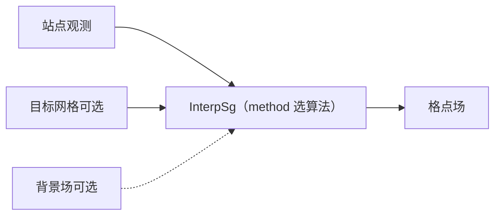

**基础信息**
- **所属包**: `interpolation_station_grid`
- **预报类型**: 语义与时空标准化
- **算法类别**: `ancillaries`
- **正式目录规划**: `NIMM/ancillaries/interpolation_station_grid/`
- **对外入口**: `InterpSg`
- **CLI 页**: [interpolation_station_grid](https://www.showdoc.com.cn/2598854776811541/11559060627727594)

站点→格点插值的统一入口：由 **`method`** 选择反距离（`idw`，可选乘高斯核）、最近邻×高斯（`gaussian`）、局部普通克里金（`kriging`）或 Cressman（`cressman`）；由 **`reprocess`** 选择插值对象：`False` 直接用站点值插值，`True` 先算站点相对背景的偏差再对偏差插值并叠回（Cressman 为创新量累加）。接口统一为 `process(sta, grid=None, background=None)`；`grid` 与 `background` 至少其一，缺 `grid` 时可从背景取水平网格。样例要素为阵风/风速（m/s）。读路径、写盘与命令行见 CLI 页。

**算法功能与流程**



1. **输入**：站点表；`grid` / `background` 至少其一（均可只传背景）。
2. **`method`**：取 `idw`（默认）/ `gaussian` / `kriging` / `cressman`；未知或为空会报错。各算法专有参数只对相应 `method` 生效，其余忽略。
3. **`reprocess=False`（默认）**：直接用站点值插值；IDW / Gaussian 超出半径的格点回退背景（无背景填 0），Cressman 以背景为初场（无背景从 0 场起），Kriging 无硬截断，有背景时**只取网格**。
4. **`reprocess=True`**：须 `background`；先算站点与背景场的偏差，再对偏差插值并叠回（Cressman 为相对当前分析场的创新量累加）。`gaussian` 与 `reprocess` 相互独立：偏差路径默认纯 IDW 权重，需要高斯权重时显式 `gaussian=True`。

# InterpSg

<div style="margin:8px 0;padding:10px 14px;background:#e8f3ff;border-left:4px solid #1677ff;border-radius:4px;overflow-x:auto;"><div style="margin:0;padding:0;background:transparent;border:none;color:#1677ff;font-weight:600;font-size:16px;line-height:1.55;font-family:Consolas,Menlo,Monaco,monospace;white-space:pre;">InterpSg(<br>&nbsp;&nbsp;&nbsp;&nbsp;method=&#39;idw&#39;,<br>&nbsp;&nbsp;&nbsp;&nbsp;&#42;,<br>&nbsp;&nbsp;&nbsp;&nbsp;reprocess=False,<br>&nbsp;&nbsp;&nbsp;&nbsp;outer&#95;value=None,<br>&nbsp;&nbsp;&nbsp;&nbsp;effectR=1000,<br>&nbsp;&nbsp;&nbsp;&nbsp;nearNum=None,<br>&nbsp;&nbsp;&nbsp;&nbsp;decrease=2,<br>&nbsp;&nbsp;&nbsp;&nbsp;gaussian=None,<br>&nbsp;&nbsp;&nbsp;&nbsp;halfR=20,<br>&nbsp;&nbsp;&nbsp;&nbsp;model=&#39;spherical&#39;,<br>&nbsp;&nbsp;&nbsp;&nbsp;sill=None,<br>&nbsp;&nbsp;&nbsp;&nbsp;range&#95;=None,<br>&nbsp;&nbsp;&nbsp;&nbsp;nugget=0.0,<br>&nbsp;&nbsp;&nbsp;&nbsp;r&#95;list=None,<br>&nbsp;&nbsp;&nbsp;&nbsp;rain&#95;limit=None,<br>&nbsp;&nbsp;&nbsp;&nbsp;num&#95;limit=1.0,<br>&nbsp;&nbsp;&nbsp;&nbsp;smooth=0.001,<br>&nbsp;&nbsp;&nbsp;&nbsp;power&#95;param=2.0,<br>&nbsp;&nbsp;&nbsp;&nbsp;r&#95;km&#95;scale=1.35,<br>&nbsp;&nbsp;&nbsp;&nbsp;innov&#95;gain=1.0,<br>&nbsp;&nbsp;&nbsp;&nbsp;residual&#95;passes=0,<br>&nbsp;&nbsp;&nbsp;&nbsp;residual&#95;degree&#95;polish=True,<br>&nbsp;&nbsp;&nbsp;&nbsp;residual&#95;polish&#95;rounds=1,<br>&nbsp;&nbsp;&nbsp;&nbsp;degree&#95;blend=0.85,<br>&nbsp;&nbsp;&nbsp;&nbsp;station&#95;anchor&#95;radius=0.35,<br>&nbsp;&nbsp;&nbsp;&nbsp;station&#95;anchor&#95;strength=0.0,<br>).process(sta, grid=None, background=None)</div></div>

**功能**：按 `method` 构造对应算法并转调其 `process`，对外只暴露这一个入口；构造参数全部显式列出，未用于当前 `method` 的项忽略。

- **输入**：站点表 `sta`；目标网格 `grid` 与背景场 `background`（至少其一）。
- **处理**：按 `method` 选算法，按 `reprocess` 选绝对值路径或偏差/创新量路径。
- **输出**：六维格点场 `xr.DataArray`。

各 `method` 使用的参数：

| method | 原理 | 专有参数 |
| --- | --- | --- |
| `idw` | 近邻反距离加权；`gaussian=True` 再乘高斯核 | `effectR`、`nearNum`、`decrease`、`gaussian` |
| `gaussian` | 每格点最近 1 站 × `exp(-(d/halfR)^2)`，`d > halfR` 硬截断 | `halfR` |
| `kriging` | 局部普通克里金（无硬截断，奇异时退化为 IDW） | `model`、`sill`、`range_`、`nugget`、`nearNum` |
| `cressman` | 多圈 Cressman 加权；`reprocess=True` 为创新量累加 | `r_list`、`nearNum`，以及仅 `reprocess=True` 生效的 `rain_limit` ～ `station_anchor_strength` |

所有距离、半径（`effectR`、`halfR`、`range_`，以及 `reprocess=False` 时的 `r_list`）单位均为千米，可写小数；`reprocess=True` 的 Cressman `r_list` 以度为单位。

**构造参数**

| 参数 | 说明 |
| --- | --- |
| <span style="color:#1677ff;font-weight:600;font-size:16px">method</span> | **类型**：`str`，默认 `"idw"`<br>**作用**：选择插值算法<br>**约束**：仅 `idw` / `gaussian` / `kriging` / `cressman`（忽略大小写与首尾空白）；其它取值或空值抛 `ValueError` |
| <span style="color:#1677ff;font-weight:600;font-size:16px">reprocess</span> | **类型**：`bool`（也接受 `"true"` / `"false"` 字符串），默认 `False`<br>**作用**：`False` 直接用站点值插值；`True` 先算站点与背景场的偏差再对偏差插值并叠回（Cressman 为创新量累加）<br>**约束**：`True` 时须传 `background`；与 `gaussian` 相互独立 |
| <span style="color:#1677ff;font-weight:600;font-size:16px">outer_value</span> | **类型**：`float / None`，默认 `None`<br>**作用**：背景对齐到目标网格时，越界格点的填充值<br>**约束**：仅在背景需要对齐时使用（Cressman 的 `reprocess=True` 直接在背景网格上运算，不使用；Kriging 的 `reprocess=False` 背景只取网格，不使用） |
| <span style="color:#1677ff;font-weight:600;font-size:16px">effectR</span> | **类型**：`float / None`，默认 `1000`<br>**作用**：仅 `idw`。`gaussian=False` 时为硬截断半径（`d > effectR` 的格点：`reprocess=False` 回退背景、无背景填 0，`reprocess=True` 偏差为 0 即保留背景）；`gaussian=True` 时为高斯衰减尺度<br>**约束**：单位千米，应 `> 0`，可写小数<br>**示例**：`effectR=150` |
| <span style="color:#1677ff;font-weight:600;font-size:16px">nearNum</span> | **类型**：`int / None`，默认 `None`<br>**作用**：`idw` / `kriging` / `cressman` 每格点参与加权的近邻站点数<br>**约束**：`None` 时用各算法默认（`idw` 8、`kriging` 20、`cressman` 100）；`gaussian` 忽略 |
| <span style="color:#1677ff;font-weight:600;font-size:16px">decrease</span> | **类型**：`int`，默认 `2`<br>**作用**：仅 `idw`，距离衰减指数，权重 `1 / d^decrease` |
| <span style="color:#1677ff;font-weight:600;font-size:16px">gaussian</span> | **类型**：`bool / None`，默认 `None`（按 `False`）<br>**作用**：仅 `idw`，权重再乘 `exp(-(d/effectR)^2)`<br>**约束**：与 `reprocess` 无关，不会随 `reprocess` 自动开启 |
| <span style="color:#1677ff;font-weight:600;font-size:16px">halfR</span> | **类型**：`float / None`，默认 `20`<br>**作用**：仅 `gaussian`，高斯半径；`d > halfR` 硬截断<br>**约束**：单位千米，须 `> 0`（否则抛 `ValueError`），可写小数<br>**示例**：`halfR=12.5` |
| <span style="color:#1677ff;font-weight:600;font-size:16px">model</span> | **类型**：`str`，默认 `"spherical"`<br>**作用**：仅 `kriging`，变异函数模型<br>**约束**：`spherical` / `exponential` / `gaussian` |
| <span style="color:#1677ff;font-weight:600;font-size:16px">sill</span> | **类型**：`float / None`，默认 `None`<br>**作用**：仅 `kriging`，基台；`None` 用站点方差 |
| <span style="color:#1677ff;font-weight:600;font-size:16px">range_</span> | **类型**：`float / None`，默认 `None`<br>**作用**：仅 `kriging`，变程；`None` 自动估计<br>**约束**：单位千米 |
| <span style="color:#1677ff;font-weight:600;font-size:16px">nugget</span> | **类型**：`float`，默认 `0.0`<br>**作用**：仅 `kriging`，块金值<br>**约束**：须 `>= 0` |
| <span style="color:#1677ff;font-weight:600;font-size:16px">r_list</span> | **类型**：`list[float] / None`，默认 `None`<br>**作用**：仅 `cressman`，影响半径列表，按列表顺序逐圈扫描<br>**约束**：`None` 时按 `reprocess` 取默认：`False` 为 `(60.0, 40.0, 20.0)`（千米），`True` 为 `(1.0, 0.8, 0.6, 0.4)`（度）<br>**示例**：`[200, 100, 50]`（`reprocess=False`，千米）；`[1.0, 0.8, 0.6, 0.4]`（`reprocess=True`，度） |
| <span style="color:#1677ff;font-weight:600;font-size:16px">rain_limit</span> | **类型**：`float / None`，默认 `None`<br>**作用**：仅 `cressman` 且 `reprocess=True`，降水回退阈值；格点值 ≤ 阈值时回退（步内回退到该步之前的场值，结束时回退到背景场）<br>**约束**：`None` 不回退；`reprocess=False` 时忽略 |
| <span style="color:#1677ff;font-weight:600;font-size:16px">num_limit</span> | **类型**：`float`，默认 `1.0`<br>**作用**：仅 `cressman` 且 `reprocess=True`，影响圆内最少站点数门槛<br>**约束**：`>= 0` |
| <span style="color:#1677ff;font-weight:600;font-size:16px">smooth</span> | **类型**：`float`，默认 `0.001`<br>**作用**：仅 `cressman` 且 `reprocess=True`，站上 IDW 取背景时的平滑项<br>**约束**：`>= 0` |
| <span style="color:#1677ff;font-weight:600;font-size:16px">power_param</span> | **类型**：`float`，默认 `2.0`<br>**作用**：仅 `cressman` 且 `reprocess=True`，站上 IDW 距离幂次<br>**约束**：`> 0` |
| <span style="color:#1677ff;font-weight:600;font-size:16px">r_km_scale</span> | **类型**：`float`，默认 `1.35`<br>**作用**：仅 `cressman` 且 `reprocess=True`，度制半径换成千米半径时的缩放<br>**约束**：`> 0`；`degree_blend=1.0` 时不起作用 |
| <span style="color:#1677ff;font-weight:600;font-size:16px">innov_gain</span> | **类型**：`float`，默认 `1.0`<br>**作用**：仅 `cressman` 且 `reprocess=True`，创新量增益系数<br>**约束**：`>= 0`；`degree_blend=1.0` 时不起作用 |
| <span style="color:#1677ff;font-weight:600;font-size:16px">residual_passes</span> | **类型**：`int`，默认 `0`<br>**作用**：仅 `cressman` 且 `reprocess=True`，残差再扫遍数<br>**约束**：`>= 0`；`degree_blend=1.0` 时不起作用 |
| <span style="color:#1677ff;font-weight:600;font-size:16px">residual_degree_polish</span> | **类型**：`bool`，默认 `True`<br>**作用**：仅 `cressman` 且 `reprocess=True`，残差扫之后是否做度制抛光<br>**约束**：`degree_blend=1.0` 时不起作用 |
| <span style="color:#1677ff;font-weight:600;font-size:16px">residual_polish_rounds</span> | **类型**：`int`，默认 `1`<br>**作用**：仅 `cressman` 且 `reprocess=True`，度制抛光轮数<br>**约束**：`>= 0`；`degree_blend=1.0` 时不起作用 |
| <span style="color:#1677ff;font-weight:600;font-size:16px">degree_blend</span> | **类型**：`float`，默认 `0.85`<br>**作用**：仅 `cressman` 且 `reprocess=True`，千米核扫描结果与纯度制结果的融合权重<br>**约束**：取值 `[0, 1]`；`1.0` 为纯度制，此时 `r_km_scale`、`innov_gain`、`residual_*` 不起作用 |
| <span style="color:#1677ff;font-weight:600;font-size:16px">station_anchor_radius</span> | **类型**：`float`，默认 `0.35`<br>**作用**：仅 `cressman` 且 `reprocess=True`，站点锚定影响半径<br>**约束**：单位度，`> 0` |
| <span style="color:#1677ff;font-weight:600;font-size:16px">station_anchor_strength</span> | **类型**：`float`，默认 `0.0`<br>**作用**：仅 `cressman` 且 `reprocess=True`，站点锚定强度，使结果向观测靠拢<br>**约束**：取值 `[0, 1]`；`0` 关闭 |

**process 参数**

| 参数 | 说明 |
| --- | --- |
| <span style="color:#1677ff;font-weight:600;font-size:16px">sta</span> | **类型**：meteva_base 站点表<br>**作用**：待插值的**站点场**，须含经纬与观测值；按 `member` / `level` / `time` / `dtime` 切片后分别插值再拼接<br>**约束**：取表**末列**（多要素时只插最后一列）；无效值先剔除 |
| <span style="color:#1677ff;font-weight:600;font-size:16px">grid</span> | **类型**：`meb.grid` 等网格信息 / `None`，默认 `None`<br>**作用**：目标**网格信息**，决定输出场的水平经纬范围与分辨率<br>**约束**：`grid` 与 `background` 至少其一；`None` 时从 `background` 取网格；传入的是网格定义，不是背景场值；`cressman` 且 `reprocess=True` 时分析锁在 `background` 网格上，独立传入的扩域 `grid` 被忽略<br>**示例**：`meb.get_grid_of_data(bg)` |
| <span style="color:#1677ff;font-weight:600;font-size:16px">background</span> | **类型**：六维 `xr.DataArray` / `None`，默认 `None`<br>**作用**：背景格点场。`reprocess=False`：`idw` / `gaussian` 超出半径的格点回退为背景值（无背景填 0），`cressman` 作多圈扫描前的初场（无背景从 0 场起），`kriging` 仅用于缺 `grid` 时取网格、场值不参与插值。`reprocess=True`：在站点上算 `obs−bg` 并插值，再叠回背景得到分析场<br>**约束**：`reprocess=True` 时**必需**；背景需要对齐时（`cressman` 的 `reprocess=True` 除外）经 `InterpGgLinear` 对齐到目标网格，越界值由 `outer_value` 控制 |
| <span style="color:#1677ff;font-weight:400;font-size:16px">return</span> | **类型**：`xr.DataArray`<br>**说明**：六维格点场（member / level / time / dtime / lat / lon）；`reprocess=True` 时成员名常为 `data0`，`False` 时多为站点要素名；`attrs` 继承自输入站点 |

**使用示例**

包内真实样例：`resource/obs_gust_d24.csv`（阵风，dtime=24）与 `resource/bg_fcst_idw.nc`（约 0.1°），数据已整理为 meteva_base 站点表与六维格点场。本节演示 `method="idw"` + **`reprocess=True`（对偏差插值再叠回）**：先调用与返回，再画输入站点、订正前背景、订正后结果（共用 `wind_speed` 色标）；换 `method` 即可切换其它算法。

```python
from pathlib import Path
import meteva_base as meb
from interp_sg_plugin import InterpSg

# 读站点与背景；目标网格从背景取
PKG = Path("interpolation_station_grid/resource")
obs = meb.read_stadata_from_csv(str(PKG / "obs_gust_d24.csv"))
bg = meb.read_griddata_from_nc(str(PKG / "bg_fcst_idw.nc"))
tgt = meb.get_grid_of_data(bg)

# reprocess=True：先算站点−背景偏差，再对偏差做 IDW（半径 150 千米）并叠回
fused = InterpSg(
    method="idw", reprocess=True, effectR=150, nearNum=8, decrease=2, outer_value=0.0
).process(obs, tgt, background=bg)
print(fused)
```

```
<xarray.DataArray 'data0' (member: 1, level: 1, time: 1, dtime: 1, lat: 71,
                           lon: 210)> Size: 60kB
array([[[[[[14.652872 , 13.959169 , 13.870783 , ..., 12.191032 ,
            12.2226715, 12.262427 ],
           [14.890355 , 14.230514 , 14.153165 , ..., 12.084795 ,
            12.124977 , 12.172665 ],
           [15.165756 , 15.116795 , 14.50066  , ..., 11.965042 ,
            12.014806 , 12.07347  ],
           ...,
           [14.58208  , 14.638617 , 14.710728 , ..., 15.564529 ,
            15.691521 , 15.81501  ],
           [14.635724 , 15.337983 , 15.363322 , ..., 15.810974 ,
            15.8931465, 15.980846 ],
           [15.458416 , 15.473828 , 15.502932 , ..., 16.033077 ,
            16.083733 , 16.141905 ]]]]]],
      shape=(1, 1, 1, 1, 71, 210), dtype=float32)
Coordinates:
  * member   (member) <U5 20B 'data0'
  * level    (level) float32 4B 0.0
  * time     (time) datetime64[ns] 8B 2026-06-02
  * dtime    (dtime) int32 4B 24
  * lat      (lat) float64 568B 31.54 31.64 31.74 31.84 ... 38.34 38.44 38.54
  * lon      (lon) float64 2kB 99.6 99.7 99.8 99.9 ... 120.2 120.3 120.4 120.5
Attributes:
    units:               
    model_var:           
    dtime_units:         hour
    level_type:          isobaric
    time_type:           UT
    time_bounds:         [0, 0]
    data_start_columns:  6
```

```python
import matplotlib.pyplot as plt
import numpy as np
from meteva_base.tool.color_tools import get_cmap_and_clevs_by_element_name
from meteva_base.tool.plot_tools import pcolormesh_2d_grid

plt.rcParams["font.sans-serif"] = ["Microsoft YaHei", "SimHei", "DejaVu Sans"]
plt.rcParams["axes.unicode_minus"] = False

map_extend = [float(bg.lon.min()), float(bg.lon.max()), float(bg.lat.min()), float(bg.lat.max())]
cmap, clevs = get_cmap_and_clevs_by_element_name("wind_speed")
clevs = np.asarray(clevs, dtype=float)

# 输入站点
axs = meb.creat_axs(1, map_extend, ncol=1, height=6.5, width=12, dpi=120,
                    title_list=["输入-站点阵风 obs_gust"])
meb.add_scatter(axs[0], obs, cmap=cmap, clevs=clevs, point_size=28, add_colorbar=True,
                title="输入-站点阵风 obs_gust", title_fontsize=12)
plt.savefig("sg_obs_sta.png", dpi=120, bbox_inches="tight"); plt.close("all")

# 订正前：背景场
pcolormesh_2d_grid(
    bg, save_path="sg_before_bg.png", title="订正前-背景场",
    cmap=cmap, clevs=clevs, show=False, dpi=120, height=6.5, width=12,
)

# 订正后：分析场 + 叠站
axs = meb.creat_axs(1, map_extend, ncol=1, height=6.5, width=12, dpi=120,
                    title_list=["订正后-InterpSg(idw)"])
meb.add_contourf(axs[0], fused, cmap=cmap, clevs=clevs, cut_colorbar=False, add_colorbar=True,
                 title="订正后-InterpSg(idw)", title_fontsize=12)
meb.add_scatter(axs[0], obs, cmap=cmap, clevs=clevs, point_size=28, add_colorbar=False,
                title="订正后-InterpSg(idw)", title_fontsize=12)
plt.savefig("sg_after.png", dpi=120, bbox_inches="tight"); plt.close("all")
```

输入站点阵风：


订正前-背景场：


订正后-InterpSg(idw)（叠站，同色标）：


---

算法 CLI 使用说明请见 [interpolation_station_grid](https://www.showdoc.com.cn/2598854776811541/11559060627727594)。
