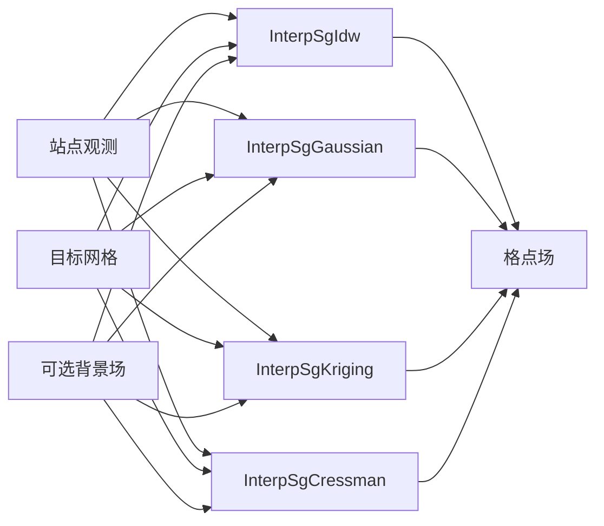

**基础信息**
- **所属包**: `interpolation_station_grid`
- **预报类型**: 语义与时空标准化
- **算法类别**: `ancillaries`
- **正式目录规划**: `NIMM/ancillaries/interpolation_station_grid/`
- **对外入口**: `InterpSgIdw`、`InterpSgGaussian`、`InterpSgKriging`、`InterpSgCressman`
- **CLI 页**: [interpolation_station_grid](https://www.showdoc.com.cn/2598854776811541/11559060627727594)

站点→格点插值：反距离（IDW / IDW×高斯）、最近邻×高斯、局部普通克里金、Cressman 逐步订正。均可选背景场（有背景时先插偏差再叠回；Cressman 以背景为初估场）。样例要素为阵风/风速（m/s）。读路径、写盘与命令行见 CLI 页。

**算法功能与流程**



1. 选入口类，传入站点表与目标 `meb.grid`；可选 `background` 走偏差订正（Cressman 为逐步订正初估）。
2. `InterpSgIdw`：`gaussian=False` 为纯 IDW（`effectR` 硬截断）；`gaussian=True` 为 IDW×高斯（`effectR` 作高斯半径）。
3. `InterpSgGaussian` 最近邻×高斯；`InterpSgKriging` 局部普通克里金；`InterpSgCressman` 按 `r_list` 由大到小逐步订正。

# InterpSgIdw

<div style="margin:8px 0;padding:10px 14px;background:#e8f3ff;border-left:4px solid #1677ff;border-radius:4px;overflow-x:auto;"><div style="margin:0;padding:0;background:transparent;border:none;color:#1677ff;font-weight:600;font-size:16px;line-height:1.55;font-family:Consolas,Menlo,Monaco,monospace;white-space:pre;">InterpSgIdw(<br>&nbsp;&nbsp;&nbsp;&nbsp;effectR=1000,<br>&nbsp;&nbsp;&nbsp;&nbsp;nearNum=8,<br>&nbsp;&nbsp;&nbsp;&nbsp;decrease=2,<br>&nbsp;&nbsp;&nbsp;&nbsp;gaussian=False,<br>&nbsp;&nbsp;&nbsp;&nbsp;outer_value=None,<br>).process(sta0, grid, background=None)</div></div>

有 `background` 时先算站–格偏差再 IDW 扩散后叠回；无背景则直接插站点值。`gaussian=True` 时权重再乘 `exp(-(d/effectR)^2)`（对应 CLI `--module idw_delta` / 有背景的 `idw`）。

**构造参数**

| 参数 | 说明 |
| --- | --- |
| <span style="color:#1677ff;font-weight:600;font-size:16px">effectR</span> | 纯 IDW：硬截断半径；高斯模式：高斯衰减尺度（米量级笛卡尔距离） |
| <span style="color:#1677ff;font-weight:600;font-size:16px">nearNum</span> | 每个格点参与加权的近邻站点数 |
| <span style="color:#1677ff;font-weight:600;font-size:16px">decrease</span> | 距离衰减指数，对应 `1 / d^decrease` |
| <span style="color:#1677ff;font-weight:600;font-size:16px">gaussian</span> | 是否乘高斯核 |
| <span style="color:#1677ff;font-weight:600;font-size:16px">outer_value</span> | 背景对齐越界填充值，传给 `InterpGgLinear` |

**process 参数**

| 参数 | 说明 |
| --- | --- |
| <span style="color:#1677ff;font-weight:600;font-size:16px">sta0</span> | 站点数据（meteva_base 站点表） |
| <span style="color:#1677ff;font-weight:600;font-size:16px">grid</span> | 目标网格信息（`meb.grid` / `meb.get_grid_of_data`） |
| <span style="color:#1677ff;font-weight:600;font-size:16px">background</span> | 可选背景格点场；给出时走偏差订正 |
| <span style="color:#1677ff;font-weight:400;font-size:16px">return</span> | `xr.DataArray` 六维格点场；`attrs` 继承自站点 |

**使用示例**

包内真实样例：`resource/obs_gust_d24.csv`（阵风实况，dtime=24）与由 `fcst_wind` IDW 得到的背景场 `resource/showdoc_demo/bg_fcst_idw.nc`（约 0.1°，99.6–120.5°E / 31.5–38.5°N）。有背景订正前后共用预置 `wind_speed` 色标。

```python
from pathlib import Path
import matplotlib.pyplot as plt
import meteva_base as meb
from meteva_base.tool.color_tools import get_cmap_and_clevs_by_element_name
from meteva_base.tool.plot_tools import pcolormesh_2d_grid
from interp_sg_idw_plugin import InterpSgIdw

plt.rcParams["font.sans-serif"] = ["Microsoft YaHei", "SimHei", "DejaVu Sans"]
plt.rcParams["axes.unicode_minus"] = False

PKG = Path("interpolation_station_grid/resource")
# 站点阵风实况（dtime=24）；目标网格与背景同域约 0.1°
obs = meb.read_stadata_from_csv(str(PKG / "obs_gust_d24.csv"))
bg = meb.read_griddata_from_nc(str(PKG / "showdoc_demo" / "bg_fcst_idw.nc"))  # fcst_wind IDW 背景
tgt = meb.get_grid_of_data(bg)

# 有背景：偏差 IDW 后叠回；outer_value 防止背景对齐越界
fused = InterpSgIdw(
    effectR=150000, nearNum=8, decrease=2, outer_value=0.0
).process(obs, tgt, background=bg)
print(fused)

cmap, clevs = get_cmap_and_clevs_by_element_name("wind_speed")
pcolormesh_2d_grid(
    bg, save_path="sg_before_bg.png", title="订正前-背景场 (fcst_wind IDW)",
    cmap=cmap, clevs=clevs, show=False,
)
pcolormesh_2d_grid(
    fused, save_path="sg_idw_after.png", title="订正后-InterpSgIdw + 背景",
    cmap=cmap, clevs=clevs, show=False,
)
```

```
<xarray.DataArray 'data0' (member: 1, level: 1, time: 1, dtime: 1, lat: 71,
                           lon: 210)> Size: 60kB
array([[[[[[14.652691 , 13.959054 , 13.870782 , ..., 12.19049  ,
            12.223007 , 12.26184  ],
           [14.890098 , 14.231033 , 14.153062 , ..., 12.084724 ,
            12.125076 , 12.172698 ],
           [15.165903 , 15.116506 , 14.500373 , ..., 11.964415 ,
            12.014598 , 12.073449 ],
           ...,
           [14.581568 , 14.638022 , 14.711105 , ..., 15.564777 ,
            15.691034 , 15.815247 ],
           [14.6359005, 15.337593 , 15.362746 , ..., 15.810442 ,
            15.893227 , 15.98085  ],
           [15.458496 , 15.474094 , 15.502482 , ..., 16.032839 ,
            16.083168 , 16.141743 ]]]]]],
      shape=(1, 1, 1, 1, 71, 210), dtype=float32)
Coordinates:
  * member   (member) <U9 36B 'fcst_wind'
  * level    (level) float32 4B 0.0
  * time     (time) datetime64[ns] 8B 2026-06-02
  * dtime    (dtime) int32 4B 24
  * lat      (lat) float64 568B 31.54 31.64 31.74 31.84 ... 38.34 38.44 38.54
  * lon      (lon) float64 2kB 99.6 99.7 99.8 99.9 ... 120.2 120.3 120.4 120.5
Attributes:
    dtime_units:         hour
    level_type:          isobaric
    time_type:           UT
    time_bounds:         [0, 0]
    data_start_columns:  6
```

订正前背景场（fcst_wind IDW）：


订正后（InterpSgIdw + 背景，同色标）：


# InterpSgGaussian

<div style="margin:8px 0;padding:10px 14px;background:#e8f3ff;border-left:4px solid #1677ff;border-radius:4px;overflow-x:auto;"><div style="margin:0;padding:0;background:transparent;border:none;color:#1677ff;font-weight:600;font-size:16px;line-height:1.55;font-family:Consolas,Menlo,Monaco,monospace;white-space:pre;">InterpSgGaussian(<br>&nbsp;&nbsp;&nbsp;&nbsp;halfR=20,<br>&nbsp;&nbsp;&nbsp;&nbsp;outer_value=None,<br>).process(sta0, grid, background=None)</div></div>

每个格点只取最近 1 站，权重 `exp(-(d/halfR)^2)`；`d > halfR` 时权重为 0。有背景时同样先插偏差再叠回。

**构造参数**

| 参数 | 说明 |
| --- | --- |
| <span style="color:#1677ff;font-weight:600;font-size:16px">halfR</span> | 高斯半径（米量级）；超过该距离权重置 0 |
| <span style="color:#1677ff;font-weight:600;font-size:16px">outer_value</span> | 背景对齐越界填充值 |

**process 参数**

| 参数 | 说明 |
| --- | --- |
| <span style="color:#1677ff;font-weight:600;font-size:16px">sta0</span> / <span style="color:#1677ff;font-weight:600;font-size:16px">grid</span> | 站点表与目标网格 |
| <span style="color:#1677ff;font-weight:600;font-size:16px">background</span> | 可选背景场 |
| <span style="color:#1677ff;font-weight:400;font-size:16px">return</span> | `xr.DataArray` 六维格点场 |

**使用示例**

与上一节同一套站点 / 背景 / 色标；改用最近邻×高斯扩散。

```python
from interp_sg_gaussian_plugin import InterpSgGaussian

gaus = InterpSgGaussian(halfR=80000, outer_value=0.0).process(
    obs, tgt, background=bg
)
print(gaus)
pcolormesh_2d_grid(
    gaus, save_path="sg_gauss_after.png", title="订正后-InterpSgGaussian + 背景",
    cmap=cmap, clevs=clevs, show=False,
)
```

订正前背景场同上节；订正后：


# InterpSgCressman

<div style="margin:8px 0;padding:10px 14px;background:#e8f3ff;border-left:4px solid #1677ff;border-radius:4px;overflow-x:auto;"><div style="margin:0;padding:0;background:transparent;border:none;color:#1677ff;font-weight:600;font-size:16px;line-height:1.55;font-family:Consolas,Menlo,Monaco,monospace;white-space:pre;">InterpSgCressman(<br>&nbsp;&nbsp;&nbsp;&nbsp;r_list=(60000, 40000, 20000),<br>&nbsp;&nbsp;&nbsp;&nbsp;nearNum=100,<br>&nbsp;&nbsp;&nbsp;&nbsp;outer_value=None,<br>).process(sta0, grid, background=None)</div></div>

按 `r_list` 由大到小逐步订正：每扫相对**当前分析场**算创新量，权重 `(R^2−d^2)/(R^2+d^2)`。无背景初估为 0；有背景则以对齐后的背景为初估。

**构造参数**

| 参数 | 说明 |
| --- | --- |
| <span style="color:#1677ff;font-weight:600;font-size:16px">r_list</span> | 影响半径列表（米），按顺序逐扫 |
| <span style="color:#1677ff;font-weight:600;font-size:16px">nearNum</span> | 每格点近邻站点数上限 |
| <span style="color:#1677ff;font-weight:600;font-size:16px">outer_value</span> | 背景对齐越界填充值 |

**process 参数**

| 参数 | 说明 |
| --- | --- |
| <span style="color:#1677ff;font-weight:600;font-size:16px">sta0</span> / <span style="color:#1677ff;font-weight:600;font-size:16px">grid</span> | 站点表与目标网格 |
| <span style="color:#1677ff;font-weight:600;font-size:16px">background</span> | 可选初估场 |
| <span style="color:#1677ff;font-weight:400;font-size:16px">return</span> | `xr.DataArray` 六维格点场 |

**使用示例**

同套真实站点与背景；`r_list` 取 200/100/50 km。

```python
from interp_sg_cressman_plugin import InterpSgCressman

cress = InterpSgCressman(
    r_list=[200000, 100000, 50000], nearNum=40, outer_value=0.0
).process(obs, tgt, background=bg)
print(cress)
pcolormesh_2d_grid(
    cress, save_path="sg_cress_after.png", title="订正后-InterpSgCressman + 背景",
    cmap=cmap, clevs=clevs, show=False,
)
```


# InterpSgKriging

<div style="margin:8px 0;padding:10px 14px;background:#e8f3ff;border-left:4px solid #1677ff;border-radius:4px;overflow-x:auto;"><div style="margin:0;padding:0;background:transparent;border:none;color:#1677ff;font-weight:600;font-size:16px;line-height:1.55;font-family:Consolas,Menlo,Monaco,monospace;white-space:pre;">InterpSgKriging(<br>&nbsp;&nbsp;&nbsp;&nbsp;model='spherical',<br>&nbsp;&nbsp;&nbsp;&nbsp;sill=None,<br>&nbsp;&nbsp;&nbsp;&nbsp;range_=None,<br>&nbsp;&nbsp;&nbsp;&nbsp;nugget=0.0,<br>&nbsp;&nbsp;&nbsp;&nbsp;nearNum=20,<br>&nbsp;&nbsp;&nbsp;&nbsp;outer_value=None,<br>).process(sta0, grid, background=None)</div></div>

局部普通克里金：每格点取 `nearNum` 近邻站解 OK 方程组；矩阵奇异时退化为 IDW。`sill` / `range_` 未给时按站点样本自动估计。也可传入 `background` 做偏差订正。

**构造参数**

| 参数 | 说明 |
| --- | --- |
| <span style="color:#1677ff;font-weight:600;font-size:16px">model</span> | 变异函数：`spherical` / `exponential` / `gaussian` |
| <span style="color:#1677ff;font-weight:600;font-size:16px">sill</span> | 基台；`None` 用站点方差 |
| <span style="color:#1677ff;font-weight:600;font-size:16px">range_</span> | 变程（米量级）；`None` 自动估计 |
| <span style="color:#1677ff;font-weight:600;font-size:16px">nugget</span> | 块金值，须 `>=0` |
| <span style="color:#1677ff;font-weight:600;font-size:16px">nearNum</span> | 局部近邻站点数 |
| <span style="color:#1677ff;font-weight:600;font-size:16px">outer_value</span> | 背景对齐越界填充值 |

**process 参数**

| 参数 | 说明 |
| --- | --- |
| <span style="color:#1677ff;font-weight:600;font-size:16px">sta0</span> / <span style="color:#1677ff;font-weight:600;font-size:16px">grid</span> | 站点表与目标网格 |
| <span style="color:#1677ff;font-weight:600;font-size:16px">background</span> | 可选背景场 |
| <span style="color:#1677ff;font-weight:400;font-size:16px">return</span> | `xr.DataArray` 六维格点场 |

**使用示例**

无背景：直接将 `obs_gust` 克里金插到目标网格（输入为站点、输出为格点，无可对照的订正前格点场，故只贴结果场）。色标仍用 `wind_speed`。

```python
from interp_sg_kriging import InterpSgKriging

# 目标网格也可读 resource/target_grid.nc
tgt0 = meb.get_grid_of_data(
    meb.read_griddata_from_nc(str(PKG / "target_grid.nc"))
)
krig = InterpSgKriging(model="spherical", nearNum=12).process(obs, tgt0)
print(krig)
pcolormesh_2d_grid(
    krig, save_path="sg_krig_nobg.png", title="InterpSgKriging 无背景插值结果",
    cmap=cmap, clevs=clevs, show=False,
)
```

```
<xarray.DataArray 'data0' (member: 1, level: 1, time: 1, dtime: 1, lat: 71,
                           lon: 210)> Size: 60kB
array([[[[[[17.005768 , 16.501583 , 15.962619 , ..., 10.510852 ,
            10.85803  , 11.24303  ],
           [17.341656 , 16.835306 , 16.286818 , ..., 10.215047 ,
            10.58847  , 11.32726  ],
           [16.90556  , 17.241518 , 16.694263 , ...,  9.956402 ,
            10.626961 , 11.079279 ],
           ...,
           [16.014214 , 16.471975 , 16.467232 , ..., 10.5098295,
            10.361869 , 10.230801 ],
           [16.761734 , 16.43899  , 17.064661 , ..., 11.055417 ,
            10.390672 , 10.246423 ],
           [16.35297  , 16.908276 , 17.50143  , ..., 11.12132  ,
            10.99923  , 10.256142 ]]]]]],
      shape=(1, 1, 1, 1, 71, 210), dtype=float32)
Coordinates:
  * member   (member) <U8 32B 'obs_gust'
  * level    (level) float32 4B 0.0
  * time     (time) datetime64[ns] 8B 2026-06-02
  * dtime    (dtime) int32 4B 24
  * lat      (lat) float64 568B 31.54 31.64 31.74 31.84 ... 38.34 38.44 38.54
  * lon      (lon) float64 2kB 99.6 99.7 99.8 99.9 ... 120.2 120.3 120.4 120.5
```


---

算法 CLI 使用说明请见 [interpolation_station_grid](https://www.showdoc.com.cn/2598854776811541/11559060627727594)。
