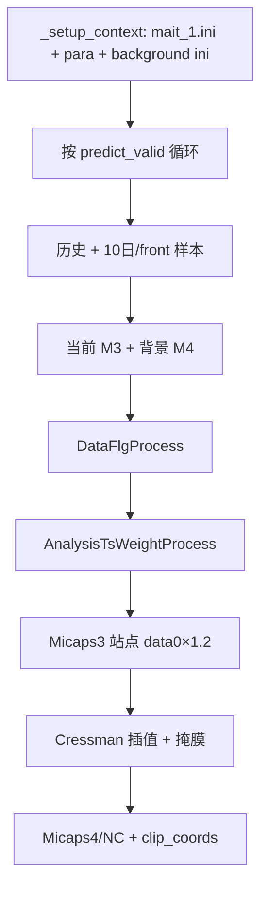

# MAIT 1h 降水自适应集成 — 程序说明

本文档说明仓库 **MAIT 1h** 的**业务场景**、**主流程**与**调用方式**，与 `nbs/multi_rain_mait01_blending.ipynb` **§1–§7** 保持一致。Notebook **§8 起**为检验与改造对比（不在本文档范围内）。

**核心源码**：

| 模块 | 文件 |
|------|------|
| 主入口 / 命令行 | `src/mait_1h_cli.py` — `process()` / `RunProcess` / Clize CLI |
| 权重与插值 | `src/mait_1_plugin.py` |
| 读数与时间 | `src/mait_1_plugin_util.py` |
| 运行上下文 | `src/utils/util_context.py` — `RunContext` |
| 插件基类 / 多进程 | `utils/base_plugin.py`、`utils/multipro_plugin.py` |
| 配置与 I/O | `utils/util_env.py`、`utils/util_new.py` |
| 运行默认项 | `resource/mait_1.ini` |

---

## 1. 适用场景

| 场景 | 说明 |
|------|------|
| **1h 多模式集成** | 读取多套模式的 **Micaps3 站点** 1h 降水，按子区 TS 动态加权，经频率匹配订正后写出站点产品，再插值到格点。 |
| **逐起报、逐时效批处理** | 支持多个 `time_input`；每个起报对 `predict_valid_list`（默认 **1–48 h**）逐小时循环。 |
| **分区权重** | `split_lat × split_lon` 划分子区；`area_scale=0.5` 扩展训练邻域后分别算 TS 与权重。 |
| **双路 TS** | **近 10 日**同时效样本 → `score_before`；**当前时效前 1 h** 样本 → `score_now`；`score_last = 0.5×score_before + 0.5×score_now`。 |
| **Micaps 产品** | 站点 **Micaps3**（`staoutputPath`）；格点 **Micaps4 + NC**（`write_grid_to_micaps4`）。 |
| **服务区约束** | 插值掩膜 `mask010.dat`；写出前按 `clip_coords` 裁剪格点。 |

---

## 2. 主流程（`RunProcess._process_single`）

### 2.1 初始化（`_setup_context`）

1. `os.chdir` → **`src/`**  
2. `get_resolved_paths()` → **`mait_1.ini`**  
3. `_prepare`：12 位 `%Y%m%d%H%M` → `dt_now`，读 `sta.info`  
4. `_analysis_para_ini`：读 **`local.ini`**（或 `para_1.ini`，由 `para_ini` 指定）  
5. `_analysis_background_ini` → **`para_1_background.ini`**  
6. `build_run_context`；background 缺键 → `ctx=None` 退出  

### 2.2 按时效循环

| 步骤 | 函数 | 要点 |
|------|------|------|
| 历史样本 | `_read_history_source_micaps3` | 昨日 fact + 模式 M3；**实况缺失则中断** |
| 评分样本 | `_read_mait_st_like_score_samples` | 10 日 + front 1h |
| 当前读数 | `_read_now_source_micaps3_nc` | M3 + 背景 M4；`dt_search_base` |
| 质检 | `DataFlgProcess` | 当前全缺 → `continue` 跳过 |
| TS 融合 | `AnalysisTsWeightProcess` | TS 0.1/1/5/10；beta 链关闭 |
| 站点 | `mait_1h_cli` | `id` 去重；**`data0×1.2`** |
| 格点 | `StationDataInterp2GridDataProcess` | Cressman + 掩膜 + FM |
| 写出 | `write_grid_to_micaps4` | `.m4` + `.nc` |

**不足 48 时效**：配置为 1–48，但模式全缺会跳过；历史 fact 缺失会中断。

### 2.3 读数分工

| 数据 | 配置 | 说明 |
|------|------|------|
| 模式 M3 | para | VVV→TTT；36h 回溯 |
| 背景 M4/NC | `para_1_background.ini` | 仅 TTT；无文件 → 全 0 格点 |
| 实况 | para 的 `fact` | `is_obs_bjt` 对齐 |

### 2.4 `dt_search_base`

`is_obs_bjt=True` 时 **`dt_now−8h`** → 用于检索与 **`grid_base.gtime`**（输出文件名 UTC 时刻）。  
例：北京 `202507020000` → 输出 `2025070116.VVV.*`。

### 2.5 数据流示意



---

## 3. 目录与核心文件

| 路径 | 作用 |
|------|------|
| `src/mait_1h_cli.py` | 主入口 |
| `src/mait_1_plugin.py` | TS、Cressman、DataFlg |
| `src/mait_1_plugin_util.py` | 读数、background、回溯 |
| `src/utils/util_context.py` | `RunContext`、`dt_search_base` |
| `utils/base_plugin.py` | `PostProcessingPlugin` 基类 |
| `utils/multipro_plugin.py` | `SimpleParallelTool` 多进程 |
| `utils/util_env.py` | `mait_1.ini` 配置解析 |
| `utils/util_new.py` | 掩码、Micaps、FM、全 0 背景 |
| `utils/data_prepare_plugin.py` | meteva 数据集准备（辅） |
| `utils/data_distribute_pulgin.py` | 数据文件分发（辅） |
| `src/mait_1_verify.py` | 检验脚本 |
| `test/mait_1_nimm_test.py` | 批量起报测试 |
| `cli/__main__.py` | `python -m cli` 转发至 `src/mait_1h_cli.py` |

## 4. 算法原理

目标：用近期历史与临近时效的技巧，给多模式 **1 小时累积降水** 动态加权，再在站点上频率匹配，并客观分析到格点。

1. **样本**  
   - 历史：昨日实况 + 同时效各模式站点场（实况缺失则该时效中断）。  
   - 评分：近 **10 日**同时效 → `score_before`；当前时效前 **1 h** → `score_now`。  
   - 当前：各模式当前 Micaps3 + 背景 Micaps4（定网格；缺背景则全 0）。

2. **分区 TS 权重**  
   按 `split_lat × split_lon` 划分子区，训练区外扩 `area_scale=0.5`。在 0.1、1、5、10 mm 四个量级上分别算 TS，四个量级的权重是 0.3、0.2、0.25、0.25，合成各模式技巧。最终评分由近 10 日的历史评分和当前时效前 1 小时的评分各占一半相加得到。没到齐的模式不参与，其余评分再归一成权重。

3. **站点融合与频率匹配**  
   当前场线性加权 \(\sum_n w_n V_n\)，经 `MetevaFrequencyMatch` 按分位映射订正；站点值另乘 1.2（业务约定）。

4. **Cressman 上格点**  
   订正站与掩膜外伪站混合，影响半径 0.6 / 0.4 / 0.2 / 0.1（倍格距量级），9 点平滑 10 次，再做格点频率匹配与极值处理，按 `clip_coords` 写出 Micaps4/NC。

---

## 5. 参数说明

### 5.1 运行参数（`mait_1.ini` / CLI 共用）

| 参数 | 类型 | 含义 |
|------|------|------|
| `time_inputs` | `list[str]` | 起报列表（12 位 `%Y%m%d%H%M`）；必填 |
| `predict_valid_list` | `list[int]` | 预报累计时效窗；默认 **1–48 h 逐小时** |
| `para_path` | `path` | 模式/实况/输出路径（`para_ini`）；默认 `resource/para_1.ini` |
| `background_ini` | `path` | 背景格点模板；默认 `resource/para_1_background.ini` |
| `beta_path` | `str` | beta 模板（主循环未用 npy 链）；默认 `beta_1h/YYYYMMDDHH` |
| `is_obs_bjt` | `bool` | 实况检索是否按北京时（−8 h）；默认 true |
| `pro_count` | `int` | 起报并行进程数（`>1` 启用）；默认 4 |
| `clip_coords` | `list[float]` | `lon0,lon1,lat0,lat1,dlon,dlat`；默认 `70,140,0,60,0.1,0.1` |
| `split_lat` / `split_lon` | `int` | 分区 TS 权重子区数；默认 1 / 1 |
| `log_file` | `str` | 日志模板；默认 `log/YYYYMMDD.txt` |
| `station_info` | `path` | 站点表；默认 `resource/sta.info` |
| `mask_dat` | `path` | 插值掩膜；默认 `resource/mask010.dat` |

未在 CLI 给出的项回落 `resource/conf.ini` 或 `mait_1.ini`。调用链：`python -m cli` → `cli/multi_rain_mait01_blending_cli.process` → `_process`（单起报）。

### 5.2 算法内部常量（代码内，非 ini）

| 参数 | 类型 | 含义 |
|------|------|------|
| `area_scale` | `float` | 训练区相对子区边长外扩；默认 0.5 |
| `predict_type` | `int` | 1 小时累积降水；默认 1 |
| TS 量级 / 权重 | `list[float]` | 分区 TS 合成；默认 0.1 / 1 / 5 / 10 mm；权重 0.3 / 0.2 / 0.25 / 0.25 |
| 双路 TS | — | 近 **10 日**同时效 + 前 **1 h**；`score_last = 0.5×score_before + 0.5×score_now`（beta 链关闭时 `score_before` 置零） |
| 站点 FM 级 | `list[float]` | `MetevaFrequencyMatch` 站点订正；默认 0.1–100 mm（15 级） |
| 站点写出系数 | `float` | 与业务 mait_st 站点幅值对齐；默认 **×1.2** |
| Cressman 半径 | `list[float]` | `gressman_interpolation_for_rain`，参数 `(1.0, 0.001, 2.0, 0.01)`；默认 **0.6 / 0.4 / 0.2 / 0.1**（倍格距） |
| 掩膜外伪站 | — | 5×5 稀疏采样背景；`mask<0` 处取背景格点 |
| 平滑 | `int` | Cressman 之后；默认 9 点 × **10** 次 |
| 格点 FM 级 | `list[float]` | 网格频率匹配；默认 0.01–250 mm（19 级） |
| 极值 / 小值 | — | ≥240→250；<0.01 置 0；1 h 不做长时效折减 |

### 5.3 路径（`para_1.ini` / `para_1_background.ini`）

| 文件 | 内容 |
|------|------|
| `para_1.ini`（或 `local.ini`） | `modelNum` + 各模式 Micaps3、`fact`、`staoutputPath` |
| `para_1_background.ini` | 背景 M4/NC，键名与 para 一致（`TTT`） |

`modelNum` 须与模式行数一致。默认模式键：`ecmwf`、`grapesgfs`、`japangfshr`、`grapes3km`、`shanghaimr`、`beijingmr`、`guangzhoumr`；占位 `YYYY` / `YYYYMMDDHH` / `VVV`。产品前缀 `staoutputPath` → 站点 `.m3`、格点 `.m4`/`.nc`。

---

## 6. 运行示例

按起报与逐小时累计窗口回算（本包根目录）：

```bash
python -m cli time_inputs=2026052400,2026052412 \
  predict_valid_list=1,2,3,4,5,6,7,8,9,10,11,12,13,14,15,16,17,18,19,20,21,22,23,24 \
  para_path=resource/para_1.ini pro_count=4
```

```python
from cli.multi_rain_mait01_blending_cli import process
process(
    time_inputs=["2026052400", "2026052412"],
    predict_valid_list=list(range(1, 25)),
    para_path="resource/para_1.ini",
    pro_count=4,
)
```

单起报、读 conf 默认时效窗：

```bash
python -m cli time_inputs=202605260800
```

跑完后在 `staoutputPath` 下核对 `YYYYMMDDHH.VVV.m3` / `.m4`；`is_obs_bjt=true` 时检索与文件名时刻按 §2.4 减 8h。失败查 `log/YYYYMMDD.txt`。
